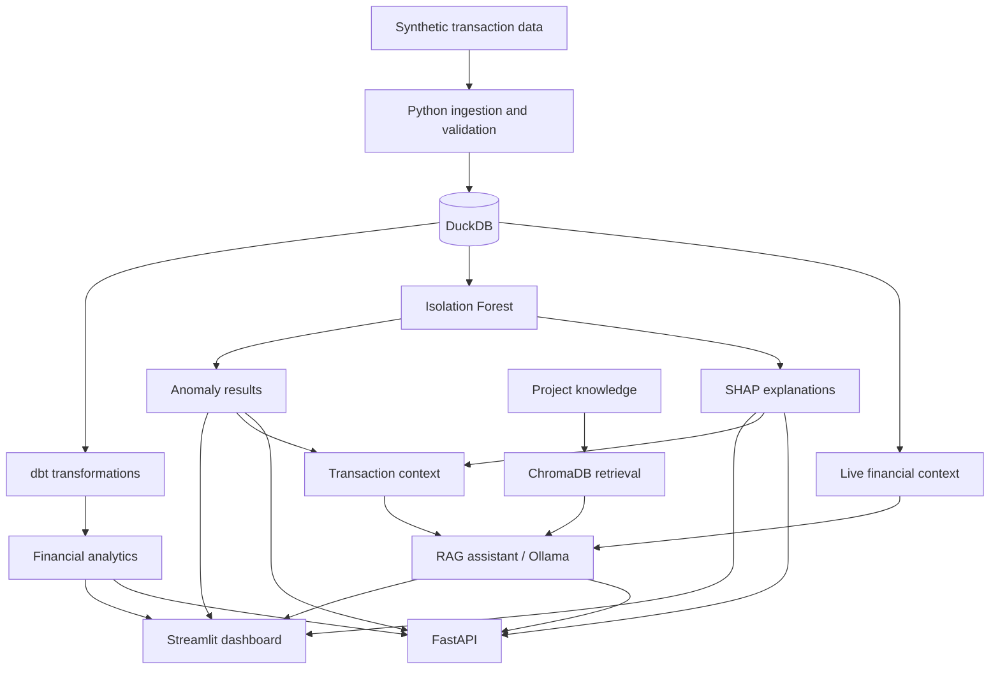

# FinSight AI

### Financial Intelligence, Anomaly Detection & Explainable AI Platform

FinSight AI is an end-to-end financial analytics portfolio project that combines **data engineering**, **business intelligence**, **machine learning**, **explainable AI**, and a **retrieval-augmented AI assistant** in one Python-based application.

The platform processes synthetic transaction data, builds analytics-ready datasets, identifies unusual transactions, explains model outputs, and exposes insights through an interactive Streamlit dashboard and FastAPI endpoints.

> **Demo data:** This project uses synthetic financial transactions. Flagged anomalies are statistical outliers, **not confirmed fraud**. Transaction amounts have no specified currency.

## Project highlights

- **1,000** synthetic transactions analysed
- **199** unique customers
- **145,377.50** total transaction value; **145.38** average transaction value
- **50** transactions flagged as anomalous (**5.0%**) using Isolation Forest
- **11** dbt tests passed during development
- **25** Python tests passed in a previously verified run (rerun locally to confirm the current version)

These are dataset and development results, not production performance or fraud-detection accuracy claims. The anomaly rate reflects the model's configured contamination setting.

## Features

### Financial analytics
- Interactive Streamlit dashboard with KPI cards, transaction trends, channel breakdowns, customer analysis, filters, and CSV exports.
- DuckDB-backed financial metrics and data-quality checks.
- dbt transformations for daily financial KPIs, channel analytics, and customer analytics.

### Machine learning anomaly detection
- Isolation Forest model for unsupervised identification of unusual transactions.
- Transaction-level anomaly scores, status flags, visual exploration, and ranked results.
- Anomaly scores in the saved results are ordered so that **higher scores indicate more unusual transactions**; they are **not fraud probabilities**.

### Explainable AI
- SHAP-based feature contributions for model output interpretation.
- Transaction-specific explanations and feature-importance visualisations.
- SHAP contributions should not be interpreted as fraud probabilities or definitive evidence of wrongdoing.

### Generative AI assistant
- Local retrieval-augmented generation (RAG) using **Ollama (`llama3.2:3b`)** and **ChromaDB**.
- Sentence embeddings with **`all-MiniLM-L6-v2`**.
- Combines retrieved project knowledge with live DuckDB metrics and transaction/anomaly context.

### API and transaction exploration
- FastAPI endpoints for health checks, analytics, anomalies, explanations, and chat.
- Transaction Explorer with filters, search, anomaly ranking, SHAP views, and CSV export.

## Technology stack

| Layer | Technologies |
| --- | --- |
| Language | Python |
| Dashboard | Streamlit, Plotly, Pandas |
| Analytical database | DuckDB |
| Data transformation | dbt-core, dbt-duckdb |
| Machine learning | scikit-learn (Isolation Forest) |
| Explainability | SHAP |
| API | FastAPI |
| Local LLM | Ollama, Llama 3.2 3B |
| Retrieval and embeddings | ChromaDB, all-MiniLM-L6-v2 |
| Testing | pytest, dbt tests |
| Version control | Git, GitHub |

## Architecture



## Dashboard pages

1. **Financial Dashboard** — overview KPIs, trends, channels, customer insights, and data checks.
2. **dbt Analytics** — transformed analytical datasets and reporting.
3. **Anomaly Detection** — anomaly distribution and transaction-level visualisation.
4. **Explainable AI** — interpretable model insights.
5. **SHAP Explanations** — feature contributions for individual predictions.
6. **AI Financial Assistant** — natural-language questions grounded in project data and knowledge.
7. **Transaction Explorer** — search, filter, inspect, and export transactions.

## Repository structure

```text
finsight-ai/
├── app/
│   ├── api/
│   │   └── main.py
│   └── dashboard/
│       ├── dashboard.py
│       └── pages/
│           ├── 1_DBT_Analytics.py
│           ├── 2_Anomaly_Detection.py
│           ├── 3_Explainable_AI.py
│           ├── 4_SHAP_Explanations.py
│           ├── 5_AI_Financial_Assistant.py
│           └── 6_Transaction_Explorer.py
├── data/
│   ├── knowledge/
│   └── processed/
├── dbt_project/
├── models/
├── src/
│   ├── explainability/
│   ├── genai/
│   ├── ingestion/
│   ├── models/
│   └── transformation/
└── README.md
```

This diagram shows the key project components, not every repository file. Generated data, model artifacts, and local vector stores may need to be created locally and may be excluded from Git.

## Run locally

### Prerequisites
- Python (developed using Python 3.12)
- Git
- Ollama, for the local AI assistant
- Project dependencies installed in a virtual environment

### 1. Clone the repository

```powershell
git clone https://github.com/Chaitanyalalam17/chaitanya-portfolio.git
cd chaitanya-portfolio\projects\finsight-ai
```

### 2. Create and activate a virtual environment (Windows PowerShell)

```powershell
python -m venv .venv
.\.venv\Scripts\Activate.ps1
```

### 3. Install project dependencies

If your repository contains a dependency lockfile or `requirements.txt`, install from that file. Otherwise, install the dependencies required by the project modules. The project uses Streamlit, Plotly, Pandas, DuckDB, dbt-core, dbt-duckdb, scikit-learn, SHAP, FastAPI, Ollama integration, ChromaDB, and pytest.

> **Reproducibility note:** A complete, pinned dependency file and a documented data/model generation sequence should be verified before claiming one-command setup from a fresh clone.

### 4. Start the dashboard

From the `projects/finsight-ai` directory:

```powershell
python -m streamlit run app/dashboard/dashboard.py
```

Open the local address displayed by Streamlit (typically `http://localhost:8501`). The dashboard expects its DuckDB database and other generated artifacts to be available locally.

### 5. Start the API (optional)

In another terminal:

```powershell
python -m uvicorn app.api.main:app --reload
```

Explore API documentation at `http://127.0.0.1:8000/docs`.

### 6. Run the local language model (optional)

Install and start Ollama, then pull the model:

```powershell
ollama pull llama3.2:3b
```

The RAG assistant also requires its local knowledge index and embeddings to be initialized. The assistant is not a hosted cloud service.

### 7. Run automated tests

```powershell
python -m pytest -v
```

For dbt tests, run the appropriate dbt command from the configured dbt project environment.

## Example API endpoints

| Method | Endpoint | Purpose |
| --- | --- | --- |
| GET | `/` | API welcome / information |
| GET | `/health` | Health check |
| GET | `/analytics/overview` | Financial overview |
| GET | `/anomalies` | Anomaly results |
| GET | `/anomalies/{transaction_id}` | Specific transaction anomaly |
| GET | `/explanations/{transaction_id}` | Transaction explanation |
| POST | `/chat` | AI assistant |

## Limitations and responsible use

- The dataset is **synthetic** and does not establish real-world banking performance.
- Isolation Forest is **unsupervised**; flagged anomalies are not verified fraud cases.
- The 5% anomaly rate is not an independently validated fraud-detection rate.
- SHAP explains model output, not causal effects or fraud likelihood.
- The local Ollama/ChromaDB setup requires additional configuration for public hosting.
- Financial outputs are illustrative and should not be used as financial advice or operational fraud decisions.

## Future opportunities

- Reproducible setup scripts and pinned dependencies.
- CI testing and deployment documentation.
- Role-based access and secure deployment architecture.
- Model monitoring and evaluation against labelled data when available.

## Author

**Chaitanya Lalam**  
MSc Data Science & Artificial Intelligence  
[GitHub portfolio](https://github.com/Chaitanyalalam17/chaitanya-portfolio)

---

*FinSight AI is a portfolio and learning project demonstrating end-to-end analytics and responsible AI integration.*
